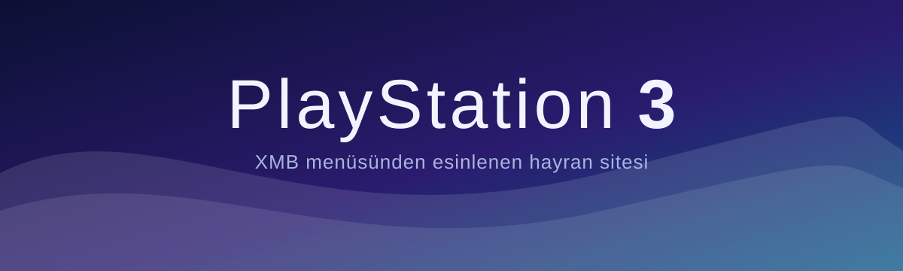
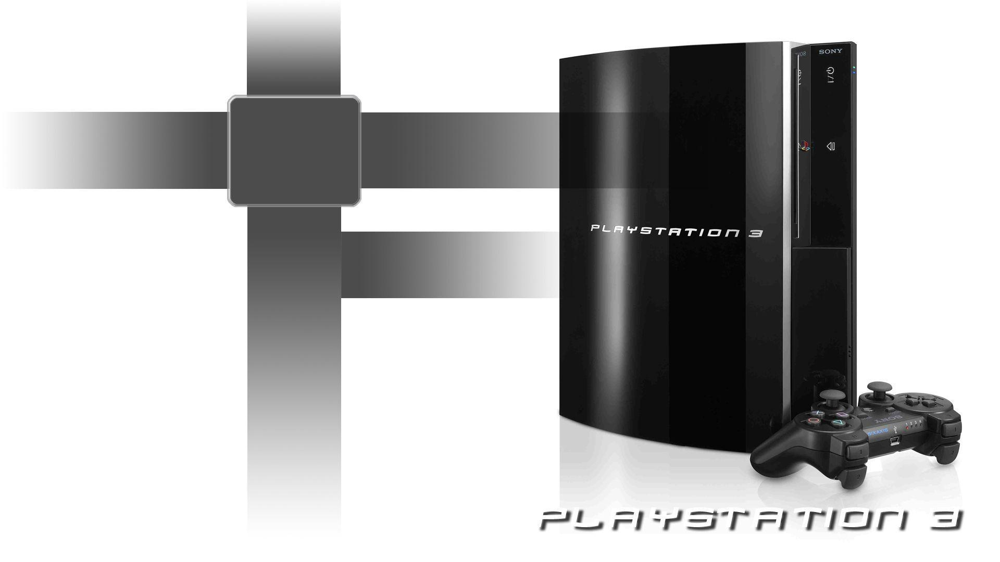
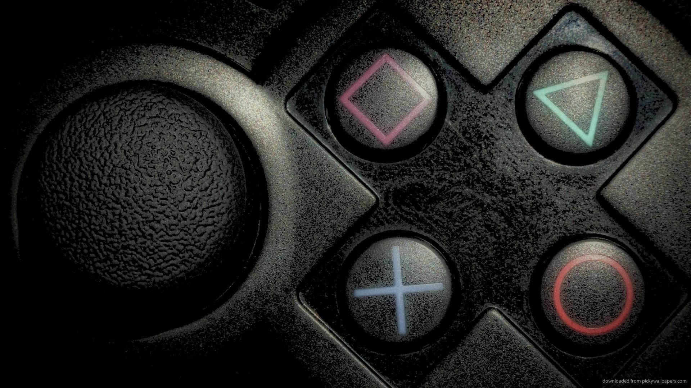

<div align="center">



<br>

**PlayStation 3 hakkında sade, hızlı ve tek sayfalık bir hayran sitesi.**
Konsolun efsane XMB menüsünden esinlenen tasarım, fotoğraf galerisi ve arka plan müziği.

<br>

[](https://edip71.github.io/ps3-site/)


</div>

---

## Ekran görüntüleri

<table>
<tr>
<td width="50%"><br><sub>PS3 Slim ve XMB dalgası</sub></td>
<td width="50%"><br><sub>İlk model PS3 ve Sixaxis</sub></td>
</tr>
<tr>
<td width="50%"><br><sub>Kol tuşları yakın çekim</sub></td>
<td width="50%"><br><sub>Nesli tanımlayan oyunlar</sub></td>
</tr>
</table>

## Neler var?

| Bölüm | İçerik |
|---|---|
| **Genel** | Çıkış tarihi, satış rakamları, tasarım |
| **Donanım** | Cell işlemci, RSX grafik, bellek, kol |
| **Modeller** | İlk model, Slim ve Super Slim zaman çizelgesi |
| **Oyunlar** | Nesle damga vuran oyunlar |
| **İlginç bilgiler** | Süper bilgisayar kümesi, Folding@home, Linux kaldırılması |
| **Galeri** | 10 fotoğraf, dokununca büyür |

## Özellikler

- XMB'den esinlenen, ekranın üstünde sabit kalan gezinme çubuğu; kaydırdıkça aktif bölüm işaretlenir
- Yavaşça akan dalga arka planı
- Tüm fotoğraflar büyütülebilir (ekrana dokunarak ya da `Esc` ile kapatma)
- Arka plan müziği: ilk dokunuşta başlar, sağ alttaki düğmeyle açılıp kapanır
- Açık ve koyu temaya uyum (`prefers-color-scheme`)
- Mobil uyumlu, klavyeyle gezilebilir, `prefers-reduced-motion` desteği
- Framework ve derleme adımı yok: saf HTML, CSS ve JavaScript

## Proje yapısı

```
ps3-site/
├── index.html        # sayfanın kendisi (HTML + CSS + JS)
├── assets/
│   ├── banner.svg    # README başlık görseli
│   ├── favicon.svg   # sekme ikonu (+ PNG sürümleri)
│   ├── bgm.mp3       # arka plan müziği
│   └── img/          # fotoğraflar
├── favicon.ico       # sekme ikonu
├── .nojekyll
└── README.md
```

## Çalıştırma

Kurulum gerekmez. `index.html` dosyasına çift tıklamanız yeterli.

Yerel sunucuyla denemek isterseniz:

```bash
python3 -m http.server 8000
# ardından http://localhost:8000 adresini açın
```

## GitHub Pages ile yayınlama

1. **Settings > Pages** bölümüne gidin.
2. **Source:** `Deploy from a branch`
3. **Branch:** `main` ve `/ (root)` seçip kaydedin.
4. Birkaç dakika içinde site `https://edip71.github.io/ps3-site/` adresinde yayında olur.

> Repo adınız `ps3-site` değilse adresin son kısmı ve yukarıdaki "Canlı site" bağlantısı repo adınıza göre değişir.

## Tasarım notları

- **Renkler:** gece mavisinden mora ve okyanus mavisine uzanan gradyan, XMB'nin klasik dalga hissini taşır.
- **Yazı tipi:** [Albert Sans](https://fonts.google.com/specimen/Albert+Sans) (Google Fonts); ince başlıklar, okunaklı gövde metni.
- **Prensip:** süs yok. Fotoğraflar ve metin ön planda, hareket yalnızca arka plan dalgasında.

## Telif notu

PlayStation ve PS3, Sony Interactive Entertainment'ın tescilli markalarıdır. Bu proje Sony ile bağlantılı değildir; hayran amaçlı ve ticari olmayan bir çalışmadır. Fotoğraflar ve müzik ilgili hak sahiplerine aittir.

## Hazırlayan

**Edip Pehlivanlı**

[](https://github.com/edip71)
[](https://www.linkedin.com/in/edip-pehlivanl%C4%B1-348146409/)
